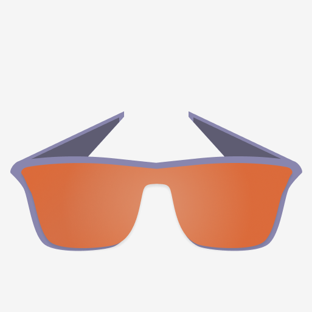
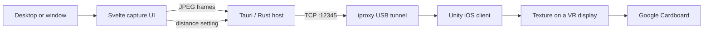

<p align="center">
  
</p>

<h1 align="center">NerdLens</h1>

<p align="center">
  <strong>Put your computer screen in a headset you already own.</strong>
  <br />
  A wired, open-source VR desktop experiment for iPhone and Google Cardboard.
</p>

<p align="center">
  <a href="https://github.com/ThatXliner/NerdLens/blob/main/LICENSE"></a>
  
</p>

---

NerdLens captures your desktop, compresses it into JPEG frames, sends those frames over USB, and renders them on a virtual screen inside a stereoscopic Cardboard view. No expensive headset. No cloud streaming. Just a phone, a cardboard viewer, and an arguably unreasonable amount of curiosity.

> [!IMPORTANT]
> NerdLens is an early proof of concept, not a polished consumer app. The current mobile project targets iOS, requires a source build, and is best suited to hacking and experimentation.

## What it can do

- Stream a selected display or window into VR at a configurable target of 10–60 FPS
- Keep traffic on a wired USB tunnel through `iproxy`
- Show a live preview, connection state, frame count, resolution, and target FPS
- Move the virtual display closer or farther away without leaving the headset
- Recover from interrupted frame writes with automatic reconnect attempts
- Keep the iPhone awake during a viewing session

## How it works



The phone runs the TCP server; the desktop host connects to `localhost:12345`, which `iproxy` forwards to the attached iPhone. Each message starts with a one-byte type followed by a big-endian payload length and the payload itself.

| Type | Payload | Purpose |
| ---: | --- | --- |
| `0` | none | Keep-alive, reserved by the client |
| `1` | JPEG bytes | Replace the texture shown in VR |
| `2` | UTF-8 JSON | Update viewer settings such as display distance |

## Quick start

### You will need

- macOS and Xcode
- An iPhone running iOS 13 or newer
- A Google Cardboard-compatible viewer
- A USB cable
- [Unity Hub](https://unity.com/download) with Unity `6000.1.5f1` and iOS Build Support
- [Bun](https://bun.sh/), [Rust](https://rustup.rs/), and the Tauri system prerequisites
- `iproxy` from [`libimobiledevice`](https://libimobiledevice.org/)

Install `iproxy` with Homebrew:

```bash
brew install libimobiledevice
```

Then clone the project:

```bash
git clone https://github.com/ThatXliner/NerdLens.git
cd NerdLens
```

### 1. Build the iPhone client

1. Open the `Test0` directory in Unity Hub using Unity `6000.1.5f1`.
2. Open `Assets/Scenes/SampleScene.unity`.
3. Switch the build target to iOS and build the Xcode project.
4. Open the generated project in Xcode, select your development team, connect your iPhone, and run the app on the device.
5. Place the phone in your Cardboard viewer after the app launches.

The Google Cardboard XR package is already declared in the Unity project and will be fetched by Unity Package Manager.

### 2. Open the USB tunnel

Connect and trust the iPhone, leave the NerdLens mobile app running, then start the tunnel in a separate terminal:

```bash
iproxy 12345 12345
```

Keep this process running for the entire session.

### 3. Start the desktop host

```bash
cd desktop
bun install --frozen-lockfile
bun run tauri dev
```

In NerdLens:

1. Select **Connect**.
2. Select **Start Recording** and choose a display or window.
3. Put on the headset.
4. Use the **Distance** slider to place the screen comfortably.

That is it. Your monitor is now wearing a monitor.

## Development

Run these commands from `desktop/`:

```bash
# Start the Svelte frontend only
bun run dev

# Type-check the frontend
bun run check

# Build the frontend
bun run build

# Run the complete desktop app
bun run tauri dev

# Validate the Rust host
cargo check --manifest-path src-tauri/Cargo.toml
```

### Project map

```text
NerdLens/
├── desktop/                       # Tauri 2 + Svelte 5 screen-streaming host
│   ├── src/routes/+page.svelte   # Capture controls, preview, and statistics
│   └── src-tauri/src/lib.rs      # TCP protocol, retries, and Tauri commands
├── Test0/                         # Unity 6 iOS/Cardboard client
│   ├── Assets/ReceiveVideo.cs    # TCP server and frame/settings decoder
│   └── Assets/Scenes/            # VR scene
├── JOURNAL.md                     # Original build log
└── Logo.png
```

## Troubleshooting

**The host says it cannot connect**

- Launch the iPhone app before selecting **Connect**.
- Confirm the phone is unlocked, trusted, and visible over USB.
- Make sure `iproxy 12345 12345` is still running.
- Check that nothing else is using local port `12345`.

**The iOS build will not sign**

- Open the generated Xcode project and choose your Apple development team.
- Give the app a unique bundle identifier if Xcode reports a conflict.
- Confirm that the connected phone is enabled for development.

**The stream freezes or stops**

- Stop and restart screen capture in the desktop host.
- Restart `iproxy`, then disconnect and reconnect from NerdLens.
- Try a lower target FPS; full-resolution JPEG encoding is intentionally simple in this prototype.

**The view is uncomfortable**

- Adjust **Distance** before putting the phone back into the viewer.
- Take regular breaks. This prototype does not yet include a complete comfort-calibration flow.

## Roadmap

- [ ] Smoother, lower-latency video transport
- [ ] Better connection and error feedback on both ends
- [ ] Automatic device discovery and `iproxy` management
- [ ] Display placement controls and axis locking
- [ ] A more polished VR environment
- [ ] Packaged desktop and mobile releases

The wonderfully candid development story—including the failed first Unity project—is in the [project journal](./JOURNAL.md).

## Contributing

Bug reports, experiments, protocol improvements, and delightfully overengineered ideas are welcome. Open an issue or send a pull request with a clear explanation of what changed and how you tested it.

## License

NerdLens is free software released under the [GNU General Public License v3.0](./LICENSE).
